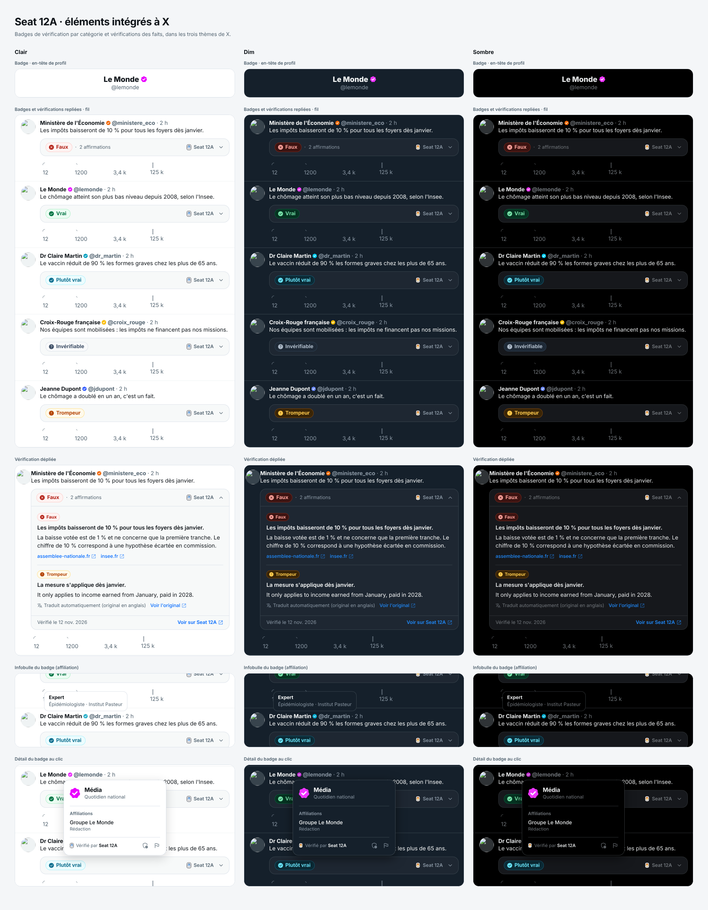

# Design

Moderne, propre, minimaliste. Le système s'inspire de celui de Bluesky : **une seule
couleur saturée** pour l'action principale, une échelle d'encres ardoise, des filets
fins, des contrôles en pilule, aucune ombre portée.

## Fondations

| Élément | Choix |
|---|---|
| Composants | [shadcn/ui](https://ui.shadcn.com) officiels (`src/ui/components/ui`), style *new-york*, ajoutés par la CLI `shadcn` |
| Icônes | [Google Material Symbols](https://fonts.google.com/icons) *Rounded*, poids 400, importés un par un en SVG (`@material-symbols/svg-400`) : seul ce qui est utilisé est embarqué |
| Typographie | **Google Sans** (variable, `@fontsource-variable/google-sans`), embarquée localement : aucune police chargée depuis un serveur tiers |
| Thèmes | clair et sombre ; `system` suit `prefers-color-scheme` en direct |

Adaptations des composants shadcn (faites dans les fichiers générés, comme le veut
shadcn) : boutons, champs et déclencheurs de `Select` en pilule (`rounded-full`), ombres
`shadow-xs` retirées, icônes `lucide-react` remplacées par Material Symbols.

## Tokens (`src/ui/globals.css`)

| Token | Clair | Sombre | Usage |
|---|---|---|---|
| `--primary` | `#006aff` | `#208bfe` | **Une** action principale par écran, liens, focus |
| `--foreground` | `#000000` | `#f1f3f5` | Titres, libellés |
| `--ink-slate` | `#405168` | `#aebbc9` | Texte courant secondaire |
| `--muted-foreground` / `--ink-steel` | `#667b99` | `#8798b0` | Méta, aides |
| `--background` | `#ffffff` | `#0e141b` | Fond |
| `--muted` | `#f9fafb` | `#161e27` | Fond de page des options |
| `--border` | `#dce2ea` | `#2e4052` | Filets 1 px |
| `--sky-tint` | `#c0dcf0` | `#3d5a75` | Touche de marque discrète |

Rayons : `12px` cartes, `21px` surfaces extérieures, `999px` contrôles. Échelle de
texte : 13 px (méta, libellés), 15 px (corps, boutons en 600), 20 px/600 titres de
section (−0,5 px d'approche), 24–30 px réservés au titre de la page d'options.

## Interface dans X

Les éléments injectés dans x.com (badges, vérifications) vivent dans un **Shadow DOM**
(styles isolés dans les deux sens) et suivent **le thème de X**, pas celui des
réglages : clair (`#ffffff`), « Dim » (`#15202b`) et « Lights out » (`#000000`) sont
détectés sur la couleur de fond de la page.

### Badges de vérification

Forme : le sceau `src/assets/brand/certif-badge.svg`, recoloré par catégorie. Couleurs
choisies pour le contraste (le serveur envoie aussi une couleur ; elle ne sert que pour
une catégorie que le client ne connaît pas encore) :

| Badge | Mode clair | Contraste sur blanc | Mode sombre | Contraste sur noir | Sur « Dim » |
|---|---|---|---|---|---|
| Institutionnel | `#F46600` | 3,1:1 | `#FF6A00` | 7,3:1 | 5,8:1 |
| Organisation | `#FFBF00` + contour `#B98B00` | contour | `#FFBF00` | 12,7:1 | 10,0:1 |
| Média | `#EA00FF` | 3,6:1 | `#EE33FF` | 6,6:1 | 5,1:1 |
| Expert | `#00A0C0` | 3,1:1 | `#00D4FF` | 11,9:1 | 9,4:1 |
| Personnalité | `#335CFF` | 5,1:1 | `#6D8AFF` | 6,8:1 | 5,3:1 |

Source unique : `src/shared/palette.ts`. Le jaune « Organisation » n'atteint pas 3:1
sur blanc : en mode clair il porte un contour `#B98B00`.

### Badge à côté du nom

Inséré **dans la ligne du nom**, à la place exacte de la coche de X (les blocs de X sont
des flex en colonne : insérer ailleurs provoque un retour à la ligne). Taille relative au
nom, mesurée sur la référence Bluesky : **0,8 em** (≈ 1,1 × hauteur des capitales),
**centré sur les capitales**, espace de **0,25 em** avant (le sceau n'a pas de blanc
interne). Le nom se tronque avant que le badge ne disparaisse.

Au clic, un **détail** : sceau + catégorie + libellé (ou « titre · organisation »),
affiliations, puis un pied discret « Vérifié par **Seat 12A** » avec deux actions en
icônes (demander un badge, signaler). Pas de croix : Échap, clic extérieur ou défilement
ferment.

### Vérifications

Une **carte** sous le post (fond doux, filet neutre, jamais de contour coloré) :

- en-tête : pastille d'issue (icône + libellé, fond teinté et contour fin dans le ton),
  nombre d'affirmations, puis la marque (hublot + « Seat 12A ») et le chevron. La marque
  est le hublot, **jamais le sceau** : le sceau signifie « compte badgé ».
- dépliée, trois niveaux par affirmation : l'affirmation (avec sa pastille seulement s'il
  y en a plusieurs), la note, une ligne discrète (sources en liens, traduction, contenu
  identique) ; la date de vérification une seule fois en pied, avec « Voir sur Seat 12A ».

Tons par issue (`veracityTone`) : vert (vrai), cyan (plutôt vrai), ambre (trompeur), rouge
(faux), ardoise (invérifiable) ; l'icône double la couleur (jamais la couleur seule). Le
post n'est jamais masqué ni modifié. Même rendu pour tous les comptes.

### Animations

Alignées sur shadcn/ui (tw-animate-css) : entrée = fondu + zoom 95 % + léger glissement
depuis l'ancre, 150–180 ms, `cubic-bezier(.16,1,.3,1)` ; sortie 100 ms ; survols 120 ms.
Popup et options : classes `animate-in` de shadcn (onglets, alertes, carte d'état,
champs conditionnels, boutons `active:scale`). Désactivées avec
`prefers-reduced-motion`.

## Marque

| Fichier | Usage |
|---|---|
| `logo-sky.svg` | Hublot ciel bleu : icône de l'extension, logo en thème clair |
| `logo-sunset.svg` | Hublot coucher de soleil : logo en thème sombre |
| `logo-full.svg` | Hublot + « Seat 12A » ; le texte est rendu en `currentColor` pour le thème sombre |
| `certif-badge.svg` | Sceau de vérification, recoloré par catégorie |

Les PNG de la barre d'outils et du Store sont générés depuis `logo-sky.svg` :
`npm run icons`.
